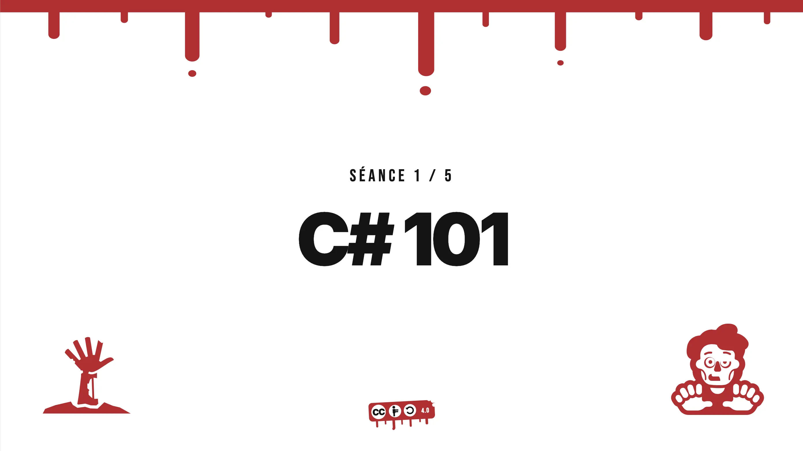

# C# 101

Découvrir C# en 6 séances de 1h30, quand on vient de `java`.



Le format est hands-on : des koans à faire passer du rouge au vert.

| Séance | Thème | Dossier |
|---|---|---|
| 1 | Fondamentaux, histoire de .NET, compilation | [`s1-fundamentals`](s1-fundamentals/README.md) |
| 2 | Types & design objet | [`s2-types`](s2-types/README.md) |
| 3 | LINQ & principes fonctionnels | [`s3-linq`](s3-linq/README.md) |
| 4 | Async & concurrence : fichiers et PostgreSQL en async, l'async avant `async` / `await` | [`s4-async`](s4-async/README.md) |
| 5 | Domain model : le Food-Truck Zombie | _à venir_ |
| 6 | L'écosystème & ASP.NET Core : Minimal API, injection de dépendances, NuGet, OpenAPI, OpenTelemetry | [`s6-aspnet`](s6-aspnet/README.md) |

## Démarrer

```bash
dotnet --version   # 10.x requis
dotnet test        # lance tous les koans (tout est rouge au départ, c'est normal !)
```

Un IDE au choix : Rider, VS Code + C# Dev Kit, ou Visual Studio. Ouvrez `csharp-101.slnx`.

## Déroulé d'une séance

Chaque séance de 1h30 suit le même rythme :

1. **Connexion** : une question ouverte pour partir de ce que vous savez déjà.
2. **Concepts** : quelques slides qui comparent Java et C# côte à côte.
3. **Pratique** : les koans, en binôme, du rouge au vert.
4. **Conclusions** : correction des koans qui ont résisté et retour sur ce qui vous a surpris.

## Structure du repo

```
csharp-101/
├── csharp-101.slnx           # la solution à ouvrir dans l'IDE (les exercices)
├── s1-fundamentals/          # une séance = un dossier
│   ├── README.md             #   consignes et liste des koans de la séance
│   ├── Koans/                #   projet de tests xUnit : les exercices à faire passer au vert
│   │   ├── 01_Syntaxe.cs     #     un fichier par thème, indépendant des autres
│   │   └── ...
│   └── demos/                #   petits programmes montrés pendant la séance
├── solutions/                # les mêmes séances, avec toutes les réponses
│   ├── Solutions.slnx
│   └── s1-fundamentals/
├── slides/                   # les supports de cours (Slidev), un fichier par séance, sous CC BY-SA 4.0
│   └── s1-fundamentals.md
├── tools/
│   └── generate-exercises.py # fabrique les exercices à partir des solutions
├── Directory.Build.props     # réglages communs à tous les projets (.NET 10, C# 14, nullable)
├── Directory.Packages.props  # versions des paquets NuGet, centralisées (xUnit v3, NFluent)
├── global.json               # version du SDK et runner de tests
├── PLAN.md                   # le programme détaillé des 6 séances
└── LICENSE                   # MIT pour le code (les slides ont leur propre LICENSE, CC BY-SA 4.0)
```

### Les koans

Un koan est un test xUnit écrit comme une phrase : `Les_chaines_sont_immuables`. Il y en a deux sortes :

- **un blanc `___` à compléter** : remplacez-le par la valeur attendue. Prédisez-la avant de lancer le test, le message d'erreur ne la donne pas ;
- **une méthode à implémenter** : elle lève `NotImplementedException` tant que vous ne l'avez pas écrite.

Les commentaires `// Java :` donnent l'équivalent Java, et les assertions [NFluent](https://www.n-fluent.net/) se lisent comme celles d'AssertJ :

```csharp
Check.That(horde.Length).IsEqualTo(3);
```

### Exercices et solutions

`solutions/` contient les koans résolus ; les dossiers `sN-*` à la racine en sont générés par `tools/generate-exercises.py`, qui remplace chaque réponse par un blanc ou par un `NotImplementedException`. Les deux arborescences ont donc toujours la même structure : si vous êtes bloqué, le fichier du même nom dans `solutions/` donne la réponse.

```bash
dotnet test solutions/Solutions.slnx   # tout est vert
```

### Les slides

Les supports sont des decks [Slidev](https://sli.dev) en Markdown, publiés en ligne sur GitHub Pages avec une page d'accueil pour choisir la séance. Pour les lancer en local :

```bash
cd slides && npm install
npm run s2     # une séance (s1, s2...), touche O pour la vue d'ensemble, P pour le mode présentateur
npm run site   # le site complet comme en ligne : page d'accueil + toutes les séances, sur http://localhost:4173
```

## Licence

- **Le code** (koans, solutions, démos, outils) est sous licence [MIT](LICENSE) : faites-en ce que vous voulez, en gardant la mention de copyright.
- **Les slides** (dossier `slides/`) sont sous licence [Creative Commons Attribution - Partage dans les mêmes conditions 4.0 International (CC BY-SA 4.0)](https://creativecommons.org/licenses/by-sa/4.0/deed.fr) : vous pouvez les réutiliser, les adapter et les partager, y compris commercialement, en citant l'auteur et en diffusant vos versions sous la même licence. Le texte complet est dans [`slides/LICENSE`](slides/LICENSE).
