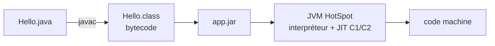
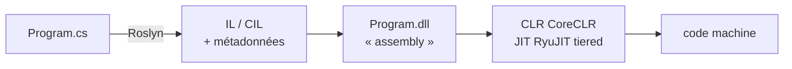

<div class="kicker mb-4">Séance 1 / 5</div>

# C# 101

<Zombie kind="hand" pos="bl" :size="6" />
<Zombie kind="zombie" pos="br" :size="6" />

<!--
Accueil. Annoncer le format : 5 séances de 1h30, très peu de slides, beaucoup de code.
Fil rouge de la formation : l'apocalypse zombie (séance 5 : le Food-Truck Zombie).
-->

---

# Au menu

| Temps | Phase |
|---|---|
| 0:00 | Qu'est-ce que C# m'inspire ? |
| 0:10 | Un peu d'histoire |
| 0:20 | Du `.cs` au processeur |
| 0:30 | La syntaxe, côte à côte |
| 0:40 | Anatomie d'un test |
| 0:45 | Koans en binôme |
| 1:15 | Conclusions |

<Zombie kind="brain" pos="br" :size="5" />

---
layout: center
---

# Qu'est-ce que C# m'inspire ?

<div class="text-center text-xl mt-6">

**2 minutes, seul·e** : un mot ou une idée par post-it

</div>

<div class="grid grid-cols-3 gap-6 mt-12 text-center" v-click>
  <div class="pill text-base">Ce que j'en sais</div>
  <div class="pill text-base">Ce que j'en ai entendu dire</div>
  <div class="pill text-base">Ce que j'aimerais savoir</div>
</div>

<Zombie kind="hand" pos="br" :size="5" />

<!--
Connexion (10 min).
1. Chacun écrit en silence 2 min : un mot ou une idée par post-it, sur C# ou .NET.
2. Au clic, on révèle les 3 colonnes : chacun vient coller ses post-its dans la bonne colonne.
3. On lit à voix haute les post-its, sans juger.

Réponses fréquentes chez les devs Java : « Microsoft », « Windows only », « une copie de Java », « Unity / jeux vidéo », « Visual Studio, c'est lourd », « LINQ », « async/await ».
→ Garder le mur de post-its affiché : on y reviendra en conclusion pour voir ce qui a bougé.
→ La partie histoire qui suit sert justement à confronter les clichés (Windows only, copie de Java) aux faits.
-->

---
layout: section
---

<div class="kicker mb-3">Partie 01</div>

# Un peu d'histoire

---

# 2002 → 2012 : la naissance

<v-clicks>

- **1996 → 2001** · Microsoft développe J++, sa JVM « améliorée »... procès de Sun → Microsoft doit créer **sa propre plateforme**
- **2002** · **.NET Framework 1.0** et **C# 1.0**, par **Anders Hejlsberg** <span class="muted">(Turbo Pascal, Delphi... puis TypeScript)</span> · Windows uniquement
- **2005** · C# 2 : **generics réifiés** <span class="muted">(Java 5 la même année, mais avec *type erasure*)</span>
- **2007** · C# 3 : **LINQ et lambdas**, 7 ans avant les Streams de Java 8
- **2010** · C# 4 : paramètres nommés et optionnels, `dynamic`
- **2012** · C# 5 : **`async/await`**, repris ensuite par JS, Python, Rust, Kotlin...

</v-clicks>

<!--
Message : C# est né d'un conflit avec Java, et s'en est vite démarqué.
Plusieurs idées aujourd'hui banales (lambdas, async/await) sont arrivées tôt en C#.
-->

---

# 2014 → 2026 : la renaissance

<v-clicks>

- **2014** · Roslyn : le compilateur réécrit en C#, **open source** (fondation .NET)
- **2016** · **.NET Core 1.0** : cross-platform (Linux, macOS), conteneurs
- **2019** · C# 8 : nullable reference types, switch expressions
- **2020** · **.NET 5** : Framework + Core + Mono fusionnés en **une seule plateforme**
- **2021 →** · une version **chaque novembre**, une **LTS** les années paires (3 ans de support)
- **2025** · **.NET 10 LTS** et **C# 14** : apps en un seul fichier, extension members
- **2026** · .NET 11 et C# 15 en preview : union types...

</v-clicks>

<div v-click class="callout mt-6 text-lg">

Le « .NET = Windows + Visual Studio » qu'on a en tête est **figé en 2014**

</div>

<!--
Revenir sur les post-its « Windows only » / « Microsoft » : open source depuis 2014, cross-platform depuis 2016.
Aujourd'hui : Rider ou VS Code sur Mac et Linux, .NET très bien placé sur les TechEmpower Benchmarks.
-->

---
layout: section
---

<div class="kicker mb-3">Partie 02</div>

# Du `.cs` au processeur

---

# Deux chaînes de compilation jumelles

<Lang name="java" />



<Lang name="csharp" class="mt-6" />



<!--
Le parallèle est presque parfait : un code intermédiaire, une VM avec JIT et GC.
-->

---

# Le dictionnaire JVM ↔ CLR

| Concept | Java | .NET |
|---|---|---|
| Code intermédiaire | bytecode | **IL** (Intermediate Language, aussi CIL ou MSIL) |
| Unité de déploiement | `.jar` | **assembly** `.dll` |
| Machine virtuelle | JVM | **CLR** (Common Language Runtime) |
| JIT | C1 / C2 | **RyuJIT** : *tiered compilation* + PGO |
| Compilation native | GraalVM `native-image` | **Native AOT**, ReadyToRun |
| Paquets | Maven Central · `pom.xml` | **NuGet** · `.csproj` |
| Autres langages | Kotlin, Scala, Clojure | **F#**, VB.NET |
| Désassembleur | `javap -c` | ILSpy · **Rider IL Viewer** · sharplab.io |

<v-clicks>

- Les **generics sont réifiés** : `List<int>` existe vraiment à l'exécution, sans boxing
- Les **types valeur** (`struct`) existent depuis le premier jour <span class="muted">(Java les attend avec Valhalla)</span>

</v-clicks>

<!--
Tiered compilation : un premier JIT rapide, puis une recompilation optimisée des méthodes « chaudes » (guidée par le profil, PGO).
SDK (pour développer) ≠ runtime (pour exécuter).
-->

---
layout: two-cols-header
---

# Ce que Roslyn écrit pour vous

::left::

```csharp
// Ce que j'écris
record Zombie(string Nom, int Faim);
```

<div class="mt-6 small">

**Pour voir l'IL** (`demos/compilation`)

- **Rider** : *Tools › IL Code* → IL Code, Low-Level C#, High-Level C#
- **sharplab.io** : coller le code, menu *Results*
- **CLI** : `ilspycmd -il bin/Debug/net10.0/Compilation.dll`

</div>

::right::

```csharp
// Ce que Roslyn génère (extrait, simplifié)
class Zombie : IEquatable<Zombie>
{
    public string Nom { get; init; }
    public int Faim { get; init; }

    public Zombie(string Nom, int Faim) { ... }

    public override string ToString() { ... }
    public override int GetHashCode() { ... }
    public virtual bool Equals(Zombie? other) { ... }
    public static bool operator ==(...) { ... }
    public void Deconstruct(out ..., out ...) { ... }
    public virtual Zombie <Clone>$() { ... }
}
```

<!--
Démo live dans Rider : ouvrir demos/compilation/Program.cs, Build, puis Tools > IL Code.
Faire deviner : combien de méthodes générées pour une ligne de record ? En quoi le foreach sur un tableau est-il transformé (boucle for avec index) ?
Que devient l'interpolation $"..." (DefaultInterpolatedStringHandler) ?
-->

---
layout: section
---

<div class="kicker mb-3">Partie 03</div>

# La syntaxe, côte à côte

---
layout: two-cols-header
---

# Variables

::left::

<Lang name="java" />

```java {all|1-4|6-8|10-13|15-18|all}{at:1}
// VARIABLES
var x = 5;
x = 6;
int explicite = 5;

// CONSTANTS
final int CONSTANTE = 5;
static final double PI = 3.14;

// STRING INTERPOLATION
var langage = "Java";
var titre = "Apprenons " + langage;
var fmt = String.format("Apprenons %s", langage);

// TEXT BLOCKS
var json = """
    {"nom": "Rick"}
    """;
```

::right::

<Lang name="csharp" />

```csharp {all|1-4|6-8|10-13|15-18|all}{at:1}
// VARIABLES
var x = 5;
x = 6;
int explicite = 5;

// CONSTANTS
const int Constante = 5;          // à la compilation
static readonly double Pi = 3.14; // une seule fois

// STRING INTERPOLATION
var langage = "C#";
var titre = $"Apprenons {langage}";
var calcul = $"Dans 10 ans : {age + 10}";

// RAW STRING LITERALS
var json = """
    {"nom": "Rick"}
    """;
```

---
layout: two-cols-header
---

# Types et strings

::left::

<Lang name="java" />

```java {all|1-4|6-8|10-12|14-16|all}{at:1}
// PRIMITIVES VS OBJECTS
int i = 42;             // primitif
Integer boxed = 42;     // objet
Integer.toString(42);

// STRING EQUALITY
a == b;                 // compare les références
a.equals(b);            // compare le contenu

// SUBSTRING
s.substring(0, 3);
s.charAt(s.length() - 1);

// BUILDER
var sb = new StringBuilder();
sb.append("bra");
```

::right::

<Lang name="csharp" />

```csharp {all|1-3|5-7|9-12|14-16|all}{at:1}
// PRIMITIVES ARE STRUCTS
int i = 42;             // alias de System.Int32
42.ToString();          // des méthodes sur les valeurs

// STRING EQUALITY
a == b;                 // compare le contenu !
ReferenceEquals(a, b);  // compare les références

// INDEXES & RANGES
s[..3];                 // les 3 premiers
s[^1];                  // le dernier caractère
s[3..6];

// BUILDER
var sb = new StringBuilder();
sb.Append("bra");       // PascalCase pour les méthodes
```

---
layout: two-cols-header
---

# Méthodes

::left::

<Lang name="java" />

```java {all|1-4|6-12|14-15|all}{at:1}
// METHODS
int carre(int x) {
    return x * x;
}

// DEFAULT PARAMETERS → overloads
String saluer(String nom) {
    return saluer(nom, "Bonjour");
}
String saluer(String nom, String salut) {
    return salut + " " + nom;
}

// MULTIPLE RESULTS → exception
int n = Integer.parseInt("123");
```

::right::

<Lang name="csharp" />

```csharp {all|1-2|4-9|11-13|all}{at:1}
// METHODS : expression-bodied
int Carre(int x) => x * x;

// DEFAULT & NAMED PARAMETERS
string Saluer(string nom, string salut = "Bonjour")
    => $"{salut} {nom}";

Saluer("Morty");
Saluer(salut: "Wubba lubba dub dub", nom: "Rick");

// MULTIPLE RESULTS : out
if (int.TryParse("123", out var n))
    Console.WriteLine(n);
```

---
layout: two-cols-header
---

# Structures de données

::left::

<Lang name="java" />

```java {all|1-4|99|6-8|10-11|all}{at:1}
// ARRAYS
int[] xs = {1, 2, 3};
xs[2];
xs[xs.length - 1];

// TUPLES → un record ou Map.Entry
record Bornes(int min, int max) {}
var b = new Bornes(1, 9);

// IMMUTABLE LIST
var ys = List.of(4, 5, 6);
```

::right::

<Lang name="csharp" />

```csharp {all|1-4|5|7-10|12-13|all}{at:1}
// ARRAYS : collection expressions
int[] xs = [1, 2, 3];
xs[2];
xs[^1];
int[] plus = [0, .. xs, 4];    // [0, 1, 2, 3, 4]

// TUPLES : natifs
(int Min, int Max) b = (1, 9);
var (min, max) = b;           // déconstruction
(a, b) = (b, a);              // swap

// IMMUTABLE LIST
IReadOnlyList<int> ys = [4, 5, 6];
```

::bottom::

<div v-click="2" class="callout small mt-2">

**Spread `..`** : déverse les éléments de `xs` à cet endroit, donc `[0, 1, 2, 3, 4]` et pas `[0, [1, 2, 3], 4]`. En Java : `Stream.concat` ou `addAll`.

</div>

---
layout: two-cols-header
---

# Structures de contrôle

::left::

<Lang name="java" />

```java {all|1-3|5-8|10-15|all}{at:1}
// CONDITIONAL
if (vivant) fuir(); else manger();
var etat = pv > 0 ? "debout" : "à terre";

// LOOPS
for (int i = 0; i < 5; i++) { }
for (String nom : noms) { }
while (x < 5) { x++; }

// SWITCH (fall-through !)
switch (jour) {
    case 6:
    case 7: weekend(); break;
    default: semaine();
}
```

::right::

<Lang name="csharp" />

```csharp {all|1-3|5-8|10-16|all}{at:1}
// CONDITIONAL
if (vivant) Fuir(); else Manger();
var etat = pv > 0 ? "debout" : "à terre";

// LOOPS
for (var i = 0; i < 5; i++) { }
foreach (var nom in noms) { }
while (x < 5) { x++; }

// SWITCH (pas de fall-through : erreur de compilation)
switch (jour)
{
    case 6:
    case 7: Weekend(); break;
    default: Semaine(); break;
}
```

---
layout: two-cols-header
---

# Pattern matching

::left::

<Lang name="java" />

```java {all|1-8|10-13|99|all}{at:1}
// SWITCH EXPRESSION (Java 21)
Integer zombies = 12;
var danger = switch (zombies) {
    case 0 -> "calme";
    case Integer n when n < 5 -> "inquiétant";
    case Integer n when n < 50 -> "horde";
    default -> "fin du monde";
};

// TYPE PATTERN
if (o instanceof String s) {
    s.length();
}
```

::right::

<Lang name="csharp" />

```csharp {all|1-8|10-12|14-15|all}{at:1}
// SWITCH EXPRESSION (C# 8+)
var danger = zombies switch
{
    0 => "calme",
    < 5 => "inquiétant",
    >= 5 and < 50 => "horde",
    _ => "fin du monde",
};

// TYPE PATTERN
if (o is string s)
    s.Length;

// TUPLE PATTERN
(n % 3, n % 5) switch { (0, 0) => "BrainsBraaains", ... };
```

---
layout: two-cols-header
---

# Enums

::left::

<Lang name="java" />

```java {all|1-10|12-13|all}{at:1}
// ENUM = une classe
enum Etat {
    VIVANT, MORDU, ZOMBIE;

    boolean contagieux() {
        return this != VIVANT;
    }
}
Etat.ZOMBIE.ordinal();     // 2
Etat.valueOf("ZOMBIE");

// SETS OF FLAGS
EnumSet.of(Sens.ODORAT, Sens.OUIE);
```

::right::

<Lang name="csharp" />

```csharp {all|1-6|8-13|all}{at:1}
// ENUM = un entier nommé
enum Etat { Vivant, Mordu, Zombie }

(int)Etat.Zombie;          // 2
Enum.Parse<Etat>("Zombie");
var bizarre = (Etat)42;    //  compile !

// FLAGS : des bits
[Flags]
enum Sens { Aucun = 0, Odorat = 1, Ouie = 2, Vue = 4 }

var sens = Sens.Odorat | Sens.Ouie;
sens.HasFlag(Sens.Ouie);   // true
```

<!--
Les enums C# sont plus pauvres que ceux de Java : pas de méthodes ni de champs.
On compense avec des méthodes d'extension (séance 3) ou des records (séance 2).
-->

---
layout: two-cols-header
---

# Null

::left::

<Lang name="java" />

```java {all|1-2|4-7|9-10|12-13|all}{at:1}
// NULLABLE : annotation, non vérifiée
@Nullable String nom = null;

// SAFE NAVIGATION
Optional.ofNullable(nom)
    .map(String::length)
    .orElse(0);

// DEFAULT VALUE
Optional.ofNullable(nom).orElse("Inconnu");

// PRIMITIVES
Integer munitions = null;  // boxé
```

::right::

<Lang name="csharp" />

```csharp {all|1-3|5-6|8-10|12-14|all}{at:1}
// NULLABLE : vérifié par le compilateur
string? nom = null;
string pasNull = "Rick";   // warning si on y met null

// SAFE NAVIGATION
nom?.Length ?? 0;

// DEFAULT VALUE
nom ?? "Inconnu";
nom ??= "Inconnu";         // affecte seulement si null

// VALUE TYPES : Nullable<T>
int? munitions = null;
munitions.HasValue;        // false
```

---
layout: two-cols-header
---

# Exceptions

::left::

<Lang name="java" />

```java {all|1-2|4-6|7-9|11-12|all}{at:1}
// CHECKED EXCEPTIONS
void lire() throws IOException { }

// TRY WITH RESOURCES
try (var r = new FileReader(f)) {
    // ...
} catch (IOException e) {
    // ...
} finally { }

// VALIDATION
Objects.requireNonNull(nom, "nom");
```

::right::

<Lang name="csharp" />

```csharp {all|1-2|4-5|7-11|13-16|all}{at:1}
// PAS DE CHECKED EXCEPTIONS
void Lire() { }

// USING (IDisposable ≈ AutoCloseable)
using var r = new StreamReader(f);

// EXCEPTION FILTERS
try { /* ... */ }
catch (HttpRequestException e)
    when (e.StatusCode == HttpStatusCode.NotFound) { }
finally { }

// THROW EXPRESSION
var n = nom
    ?? throw new ArgumentNullException(nameof(nom));
ArgumentNullException.ThrowIfNull(nom);
```

---

# Les différences qui piquent

| Java | C# | Piège |
|---|---|---|
| `s1.equals(s2)` | `s1 == s2` | `==` compare le **contenu** des strings |
| `getX()` / `setX()` | propriétés `X { get; set; }` | séance 2 |
| `camelCase()` | `PascalCase()` pour méthodes et propriétés | convention .NET |
| `throws IOException` | rien | **pas de checked exceptions** |
| `switch` avec fall-through | pas de fall-through | erreur de compilation sans `break` |
| `enum` = classe | `enum` = entier nommé | `(Etat)42` compile ! |
| `package` = dossier | `namespace` libre | on les aligne quand même, par convention |
| `int` ≠ `Integer` | `int` = `System.Int32` | des méthodes sur les valeurs : `42.ToString()` |

<Zombie kind="skull" pos="br" :size="3.5" />

---

# La boîte à outils

```bash
dotnet new console -o MonApp     # ≈ mvn archetype:generate
dotnet build                     # ≈ mvn compile
dotnet run                       # compile + exécute
dotnet test                      # ≈ mvn test
dotnet add package NFluent       # ajoute une dépendance NuGet
dotnet run hello.cs              # .NET 10 : un seul fichier, sans projet (≈ java Hello.java)
```

<div class="mt-8">

**IDE** : Rider · VS Code + C# Dev Kit · Visual Studio (Windows)

</div>

<!--
Démo : demos/hello.cs, avec `dotnet run hello.cs 5`, puis le shebang (`chmod +x hello.cs && ./hello.cs`).
-->

---
layout: section
---

<div class="kicker mb-3">Partie 04</div>

# Anatomie d'un test

---
layout: two-cols-header
---

# Le même test, deux écosystèmes

<div class="step-labels">
  <span v-click="[1, 2]" class="pill">Annotation · <code>@Test</code> → <code>[Fact]</code></span>
  <span v-click="[2, 3]" class="pill">Nom de la méthode · une phrase</span>
  <span v-click="[3, 4]" class="pill">Arrange · on prépare les données</span>
  <span v-click="[4, 5]" class="pill">Act · une seule action</span>
  <span v-click="[5, 6]" class="pill">Assert · <code>assertThat</code> → <code>Check.That</code></span>
</div>

::left::

<Lang name="java">JUnit 5 + AssertJ</Lang>

```java {all|6|7|8-9|11-12|14-16|all}{at:1}
import org.junit.jupiter.api.Test;
import static org.assertj.core.api.Assertions.assertThat;

class ChainesTest {

    @Test
    void les_chaines_sont_immuables() {
        // Arrange
        var cri = "braaains";

        // Act
        var plusFort = cri.toUpperCase();

        // Assert
        assertThat(cri).isEqualTo("braaains");
        assertThat(plusFort).isEqualTo("BRAAAINS");
    }
}
```

::right::

<Lang name="csharp">xUnit + NFluent</Lang>

```csharp {all|6|7|9-10|12-13|15-17|all}{at:1}
using NFluent;
using Xunit;

public class AProposDesChaines
{
    [Fact]
    public void Les_chaines_sont_immuables()
    {
        // Arrange
        var cri = "braaains";

        // Act
        var plusFort = cri.ToUpper();

        // Assert
        Check.That(cri).IsEqualTo("braaains");
        Check.That(plusFort).IsEqualTo("BRAAAINS");
    }
}
```


<!--
D'abord faire chercher les différences aux participants, puis dérouler clic par clic : la même partie s'allume à gauche et à droite.
1. Annotation : @Test (annotation Java) devient [Fact] (attribut C#). Pas d'import de l'annotation en C# grâce au using Xunit.
2. Nom de la méthode : une phrase qui décrit le comportement. En C#, PascalCase et public obligatoire (xUnit ne découvre que les méthodes publiques), de même que la classe.
3. Arrange : identique, var dans les deux langages.
4. Act : une seule action. toUpperCase → ToUpper : PascalCase pour les méthodes .NET.
5. Assert : AssertJ et NFluent se lisent pareil, seul le point d'entrée change.
-->

---
layout: section
---

<div class="kicker mb-3">Partie 05</div>

# À vous de jouer

<Zombie pos="br" :size="8" />

---

# Les koans

Un koan est un **test rouge** à faire passer au **vert**.

<div class="grid grid-cols-2 gap-8 mt-6">
<div>

### Compléter un blanc

```csharp
var x = 42;

Check.That(x.GetType()).IsEqualTo(___);
```

**Prédisez** la valeur avant de lancer le test : le message d'erreur ne vous la donnera pas.

</div>
<div>

### Implémenter

```csharp
private static string Inverser(string mot)
{
    throw new NotImplementedException("...");
}
```

Les commentaires `// Java :` vous raccrochent à ce que vous connaissez.

</div>
</div>

```bash
cd s1-fundamentals/Koans && dotnet test
dotnet test -- --filter-class "Fundamentals.AProposDeLaSyntaxe"   # un seul fichier
```

---

# 40 minutes, en binôme

| Fichier | Thème |
|---|---|
| `01_Syntaxe.cs` | var, types, interpolation, méthodes, tuples, tableaux |
| `02_Chaines.cs` | égalité, immutabilité, ranges, StringBuilder |
| `03_ControleEtEnums.cs` | boucles, switch, switch expressions, enums |
| `04_Nullabilite.cs` | `?`, `?.`, `??`, `??=`, `Nullable<T>` |
| `05_Exceptions.cs` | try/catch/finally, filtres `when`, `using`, `checked` |

<div class="callout mt-6">

On change de pilote à chaque fichier

</div>

<Zombie kind="eye" pos="br" :size="4" />

<!--
Passer dans les binômes. Pièges habituels : `out`, les ranges `[3..6]` (borne de fin exclue), `using` (ordre du journal), `checked`.
Si un binôme finit en avance : relire les tests rédigés en NFluent et en écrire un nouveau sur un concept vu dans les slides.
-->

---

# Conclusions

<v-clicks>

- Correction live des koans qui ont posé problème
- **Tour de table** : qu'est-ce qui vous a le plus surpris par rapport à Java ?
- **Retour au mur de post-its** : qu'est-ce que vous déplaceriez, barreriez, ajouteriez ?

</v-clicks>

<!--
Les post-its de la connexion sont toujours affichés : faire déplacer les clichés démentis (Windows only...) et compléter la colonne « Ce que j'en sais ».
-->

---
layout: end
---

<div class="text-8xl mb-4"><game-icons-brain class="inline" /></div>

# Braaains !

<div class="kicker mt-2">Prochaine séance · Types et design objet</div>
