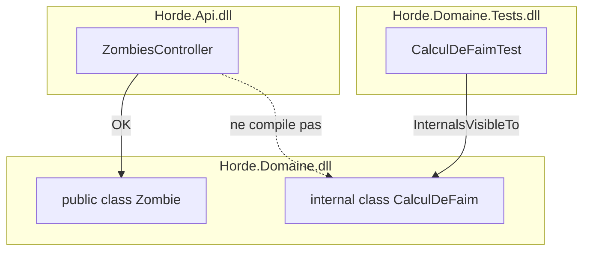
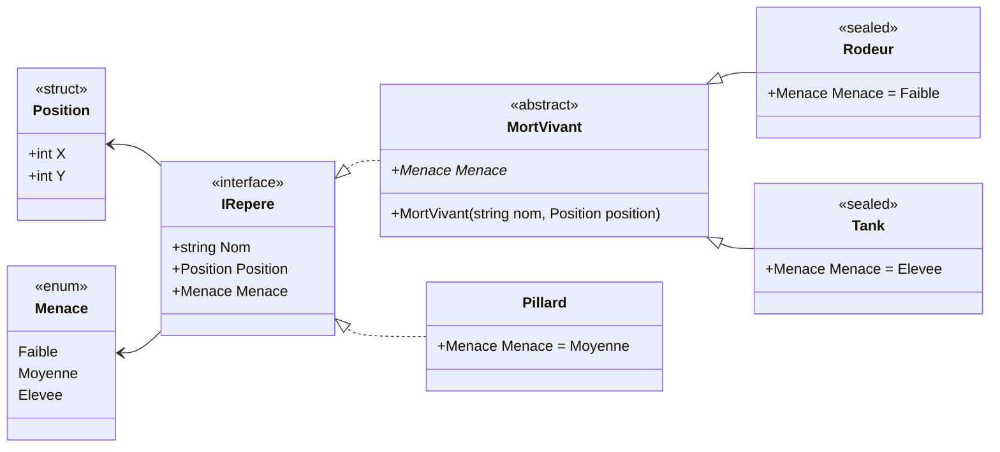

<div class="kicker mb-4">Séance 2 / 5</div>

# C# 101

## Types & design objet

<Zombie kind="tombstone" pos="bl" :size="6" />
<Zombie kind="zombie" pos="br" :size="6" />

<!--
Accueil. Rappel de la séance 1 : la syntaxe est très proche de Java.
Aujourd'hui, ce qui change vraiment : comment on modélise. Propriétés, records, struct, generics réifiés, pattern matching.
Ce sont les briques du Food-Truck Zombie de la séance 5.
-->

---

# Au menu

| Temps | Phase |
|---|---|
| 0:00 | Combien de lignes pour un zombie ? |
| 0:10 | Propriétés et encapsulation |
| 0:18 | Valeur ou référence |
| 0:22 | Héritage, records et classes static |
| 0:28 | Generics et pattern matching |
| 0:35 | Koans en binôme |
| 1:15 | Conclusions |

<Zombie kind="brain" pos="br" :size="5" />

---
layout: center
---

# Combien de lignes pour un zombie ?

<div class="text-center text-xl mt-6">

**3 minutes, en binôme** : écrivez en Java, sans Lombok ni `record`,<br>
une classe `Zombie` **immuable** avec un `nom` et une `faim`

</div>

<div class="grid grid-cols-4 gap-4 mt-10 text-center">
  <div class="pill text-base">constructeur</div>
  <div class="pill text-base">getters</div>
  <div class="pill text-base">equals / hashCode</div>
  <div class="pill text-base">toString</div>
</div>

<div v-click class="mt-10 text-center">

```csharp
record Zombie(string Nom, int Faim);
```

</div>

<Zombie kind="hand" pos="br" :size="5" />

<!--
Connexion (10 min).
1. En binôme, 3 min, sur papier ou dans l'IDE : la classe Java complète, sans générer le code.
2. On compte les lignes : en général entre 35 et 50. Qui a oublié hashCode ? Qui a un equals faux (getClass vs instanceof) ?
3. Au clic : la version C#. Une ligne, et tout ce qui est listé est généré (on l'a vu dans l'IL en séance 1).
4. Question ouverte : « Java a aussi des records depuis Java 16. Alors, qu'est-ce que C# peut bien avoir de plus ? » → c'est le fil de la séance.
-->

---
layout: section
---

<div class="kicker mb-3">Partie 01</div>

# Propriétés et encapsulation

---
layout: two-cols-header
---

# Propriétés

::left::

<Lang name="java" />

```java {all|1-4|6-8|10-11|13-15|all}{at:1}
// FIELD + GETTER + SETTER
private String nom = "Inconnu";
public String getNom() { return nom; }
public void setNom(String nom) { this.nom = nom; }

// READ-ONLY OUTSIDE
private int pv = 100;
public int getPv() { return pv; }

// COMPUTED
public boolean estVivant() { return pv > 0; }

// USAGE
rick.setNom("Rick");
rick.getNom();
```

::right::

<Lang name="csharp" />

```csharp {all|1-2|4-5|7-8|10-12|all}{at:1}
// AUTO-PROPERTY : le champ est généré
public string Nom { get; set; } = "Inconnu";

// READ-ONLY OUTSIDE
public int Pv { get; private set; } = 100;

// COMPUTED
public bool EstVivant => Pv > 0;

// USAGE : ça ressemble à un champ
rick.Nom = "Rick";
rick.Nom;
```

<!--
Une propriété, c'est une paire de méthodes get_Nom / set_Nom dans l'IL : on garde l'encapsulation, on perd le bruit.
On peut passer d'une auto-property à une propriété avec logique sans changer le code appelant.
Convention : propriétés en PascalCase, comme les méthodes.
-->

---
layout: two-cols-header
---

# Construire un objet

::left::

<Lang name="java" />

```java {all|1-5|7-9|11-14|all}{at:1}
// CONSTRUCTOR
class Rodeur {
    private final String nom;
    Rodeur(String nom) { this.nom = nom; }
}

// BUILDER (Lombok)
var arme = Arme.builder()
    .nom("Batte").degats(10).build();

// VALIDATION
public void setSolidite(int s) {
    this.solidite = Math.clamp(s, 0, 100);
}
```

::right::

<Lang name="csharp" />

```csharp {all|1-5|7-10|12-17|all}{at:1}
// PRIMARY CONSTRUCTOR (C# 12)
class Rodeur(string nom)
{
    public string Nom => nom;
}

// OBJECT INITIALIZER
var arme = new Arme { Nom = "Batte" };
// required : obligatoire · init : figé après création
public required string Nom { get; init; }

// VALIDATION : le mot-clé field (C# 14)
public int Solidite
{
    get;
    set => field = Math.Clamp(value, 0, 100);
}
```

<!--
Constructeur primaire : les paramètres sont capturés, visibles dans toute la classe, mais ce ne sont PAS des propriétés (contrairement aux records).
Initialiseur d'objet : remplace la plupart des builders. required = erreur de compilation si on oublie la propriété.
field : avant C# 14, il fallait déclarer un champ privé _solidite à la main dès qu'on voulait un peu de logique.
-->

---
layout: two-cols-header
---

# Encapsulation

::left::

<Lang name="java" />

```java {all|1-3|5-7|9-11|13-16|all}{at:1}
// PAR DÉFAUT : package-private
class Cachette { }        // visible dans le package
String surnom;            // idem

// PROTECTED : dérivées + tout le package
protected int faim;
// pas de niveau « module » pour un membre

// FINAL
final class Goule extends Zombie { }
@Override public final String cri() {...}

// COLLECTIONS
public List<String> getMembres() {
    return Collections.unmodifiableList(membres);
}
```

::right::

<Lang name="csharp" />

```csharp {all|1-3|5-8|10-12|14-16|all}{at:1}
// PAR DÉFAUT : le plus fermé possible
class Cachette { }        // internal : l'assembly
string _surnom;           // private

// PROTECTED : dérivées SEULEMENT
protected int Faim;
internal string Camp;               // tout le .dll
private protected string Code;      // dérivées ET .dll

// SEALED
sealed class Goule : Zombie { }
public sealed override string Cri() => ...;

// COLLECTIONS
public IReadOnlyList<string> Membres
    => _membres.AsReadOnly();
```

<!--
Les deux pièges pour un dev Java : sans modificateur, c'est private (membre) ou internal (classe), jamais « package ». Et protected n'ouvre PAS l'accès au reste du namespace.
internal = l'unité de déploiement (l'assembly, le .dll), pas le dossier : un namespace ne protège rien.
Aussi : protected internal (dérivées OU assembly) et file (C# 11, visible dans le fichier seulement).
Collections : exposer la List derrière un IReadOnlyList ne suffit pas, un cast la rend modifiable. AsReadOnly() renvoie une vraie vue en lecture seule.
-->

---
layout: two-cols-header
---

# `internal` : l'assembly, pas le dossier

::left::

<v-clicks>

- **Java** : sans modificateur, c'est le **package**, donc un dossier. Pour cacher un package entier, il faut les modules de Java 9 (`exports`)
- **C#** : `internal` = l'**assembly**, c'est-à-dire un projet `.csproj` compilé en `.dll`
- Les **namespaces ne protègent rien** : ce ne sont que des préfixes de noms
- C'est le **défaut des classes** : une classe qu'on oublie de rendre `public` reste dans son projet
- Pour les tests : `<InternalsVisibleTo Include="Horde.Domaine.Tests" />` dans le `.csproj`

</v-clicks>

::right::



<!--
Pour un dev Java, internal est ce qui se rapproche le plus de package-private, mais la frontière est le projet, pas le dossier : deux classes dans des namespaces différents du même projet se voient.
Bonne pratique : public = l'API du projet (ce que les autres projets peuvent utiliser), internal pour tout le reste, et sealed par défaut.
Le koan Une_classe_sans_modificateur_est_internal vérifie que Cachette, déclarée sans modificateur, n'est pas publique.
-->

---
layout: section
---

<div class="kicker mb-3">Partie 02</div>

# Valeur ou référence

---
layout: two-cols-header
---

# La différence qui n'existe pas en Java

::left::

<Lang name="java" />

```java {all|1-4|6-9|11-12|all}{at:1}
// OBJECT : copie de la référence
var a = new Position(1);
var b = a;
b.x = 10;            // a.x == 10

// PRIMITIVE : copie de la valeur
int c = 1;
int d = c;
d = 10;              // c == 1

// VALUE CLASSES → projet Valhalla
// pas de ref : tout est passé par valeur
```

::right::

<Lang name="csharp" />

```csharp {all|1-4|6-9|11-13|all}{at:1}
// CLASS : copie de la référence
var a = new PositionClasse { X = 1 };
var b = a;
b.X = 10;            // a.X == 10

// STRUCT : copie de la valeur
var c = new PositionStruct { X = 1 };
var d = c;
d.X = 10;            // c.X == 1

// REF : passer une struct par référence
void Soigner(ref Sante s) => s.Pv += 10;
Soigner(ref sante);
```

::bottom::

<div v-click="2" class="callout small mt-2">

`int`, `double`, `bool`, `decimal`, `DateTime`, `Guid`... sont des **struct** : en C#, on peut créer ses propres types valeur.

</div>

<!--
Une struct n'a pas d'identité, pas de null, pas d'héritage. Elle est copiée à chaque affectation et à chaque passage en paramètre.
Piège classique (koan) : positions[0].X = 5 ne compile pas, et var p = positions[0]; p.X = 5; ne modifie qu'une copie.
Boxing : object o = maStruct; copie la struct dans le tas, comme int → Integer.
-->

---
layout: two-cols-header
---

# `ref`, `out` et `in`

::left::

<Lang name="java" />

```java {all|1-3|5-7|9-10|all}{at:1}
// RÉFÉRENCES PASSÉES PAR VALEUR
void remplacer(Position p) { p = new Position(99); }
remplacer(pos);           // pos inchangée

// PLUSIEURS RÉSULTATS → exception ou objet
try { n = Integer.parseInt(s); }
catch (NumberFormatException e) { ... }

// MODIFIER L'ARGUMENT → un tableau à une case
int[] compteur = {0};
```

::right::

<Lang name="csharp" />

```csharp {all|1-3|5-8|10-11|all}{at:1}
// REF : la variable de l'appelant elle-même
void Remplacer(ref Position p) => p = new(99);
Remplacer(ref pos);       // pos remplacée

// OUT : la méthode DOIT affecter la variable
if (int.TryParse(s, out var n)) { ... }
bool TryFouiller(string lieu, out string trouvaille)
TryFouiller("cave", out _);         // discard

// IN : par référence, en lecture seule
double Distance(in Coordonnees a, in Coordonnees b)
```

::bottom::

<div v-click="4" class="callout small mt-2">

`ref` : initialisée **avant** l'appel · `out` : affectée **par** la méthode · hors du pattern `TryXxx`, préférez renvoyer un tuple

</div>

<!--
Le mot-clé se répète à l'appel (ref pos, out var n) : on voit tout de suite qu'un argument peut être modifié.
ref sur une struct : on évite la copie et on modifie l'original. ref sur une classe : on peut remplacer l'objet de l'appelant.
in : pour passer une grosse struct sans copie, sans pouvoir la modifier.
-->

---
layout: section
---

<div class="kicker mb-3">Partie 03</div>

# Héritage, records et classes static

---
layout: two-cols-header
---

# Héritage

::left::

<Lang name="java" />

```java {all|1-3|5-9|11-12|14-15|all}{at:1}
// EXTENDS & IMPLEMENTS
class Goule extends Creature
    implements Mordeur, Crieur { }

// OVERRIDE : tout est virtuel
@Override
public String decrire() {
    return super.decrire() + " affamée";
}

// CONSTRUCTOR
Infecte(String nom) { super(nom); }

// FINAL
final class Infecte extends Humain { }
```

::right::

<Lang name="csharp" />

```csharp {all|1-3|5-8|10-11|13-14|all}{at:1}
// UN SEUL SYMBOLE : `:`
class Goule : Creature, IMordeur, ICrieur { }
// convention : I devant les interfaces

// OVERRIDE : opt-in avec virtual
public override string Decrire()
    => base.Decrire() + " affamée";
// parent : public virtual string Decrire()

// CONSTRUCTOR
public Infecte(string nom) : base(nom) { }

// SEALED
sealed class Infecte : Humain { }
```

<!--
Classes abstraites et interfaces : mêmes concepts qu'en Java, y compris les méthodes par défaut dans les interfaces.
override est un mot-clé (pas une annotation) : oublier virtual dans le parent = erreur de compilation sur l'override.
-->

---

# Le piège : `virtual`, `override` et `new`

```csharp
class Creature
{
    public virtual string Decrire() => "une créature";
    public string Espece() => "inconnue";
}
class Goule : Creature
{
    public override string Decrire() => "une goule";
    public new string Espece() => "goule";   // masque, sans redéfinir
}
Creature c = new Goule();
```

<div class="grid grid-cols-2 gap-6 mt-4">
<div>

`c.Decrire()` <span v-click>→ **« une goule »** · virtual : le type de l'**objet** décide</span>

</div>
<div>

`c.Espece()` <span v-click>→ **« inconnue »** · non virtual : le type de la **variable** décide</span>

</div>
</div>

<div v-click class="callout small mt-4">

Idem pour les **méthodes par défaut** d'une interface : `((ICrieur)coureur).Crier()`, car `coureur.Crier()` ne compile pas.

</div>

<!--
Faire voter avant chaque clic. La plupart des devs Java répondent « goule » deux fois.
Pourquoi ce choix en C# ? Performance (appel direct, inlining) et versioning : une classe parente ne casse pas ses enfants en ajoutant une méthode du même nom.
Le compilateur émet un warning si on masque sans écrire new.
-->

---
layout: two-cols-header
---

# Records

::left::

<Lang name="java" />

```java {all|1-5|7-8|10-11|13|all}{at:1}
// RECORD (Java 16)
record Zombie(String nom, int faim) {}
var bob = new Zombie("Bob", 3);
bob.nom();
bob.toString();  // Zombie[nom=Bob, faim=3]

// EQUALITY
bob.equals(new Zombie("Bob", 3));  // true

// COPY → à la main
var affame = new Zombie(bob.nom(), 10);

// INHERITANCE → impossible (final)
```

::right::

<Lang name="csharp" />

```csharp {all|1-5|7-8|10-11|13-15|all}{at:1}
// RECORD (C# 9)
record Zombie(string Nom, int Faim);
var bob = new Zombie("Bob", 3);
bob.Nom;
bob.ToString();  // Zombie { Nom = Bob, Faim = 3 }

// EQUALITY : == compare les valeurs
bob == new Zombie("Bob", 3);       // true

// COPY : with
var affame = bob with { Faim = 10 };

// INHERITANCE
abstract record Creature(string Nom);
record Humain(string Nom) : Creature(Nom);
```

::bottom::

<div v-click="5" class="callout small mt-2">

**Immuabilité superficielle** : dans `record Groupe(List<string> Membres)`, la liste reste modifiable et `==` compare sa *référence*.

</div>

<!--
Les records C# sont des classes (type référence) avec égalité structurelle générée.
with : copie superficielle + modification, l'original ne bouge pas. Java l'a en preview (derived record creation).
Héritage : Humain("Rick") != MortVivant("Rick") même avec les mêmes valeurs, le type exact compte (EqualityContract).
-->

---
layout: two-cols-header
---

# Quand la construction peut échouer

::left::

<div class="kicker mb-2">❌ Le constructeur qui lance</div>

```csharp
record Temperature(double Celsius)
{
    public double Celsius { get; } = Celsius >= -273.15
        ? Celsius
        : throw new ArgumentOutOfRangeException();
}

var t = new Temperature(-300);   // 💥 à l'exécution
```

<div v-click="1" class="small mt-2">

Rien dans `new Temperature(-300)` ne prévient l'appelant : il découvre l'échec en production. Java fait pareil avec le constructeur compact d'un record.

</div>

::right::

<div v-click="2">

<div class="kicker mb-2">✅ Une factory method</div>

```csharp
sealed record Temperature
{
    public double Celsius { get; }
    private Temperature(double c) => Celsius = c;

    public static Temperature? Creer(double c)
        => c >= -273.15 ? new Temperature(c) : null;
}

if (Temperature.Creer(-300) is { } t) { ... }
// ou : Temperature.TryCreer(-300, out var t)
```

</div>

::bottom::

<div class="grid grid-cols-3 gap-3 mt-2 small">
<div v-click="3" class="callout">Le constructeur est <strong>privé</strong> : <code>Creer</code> est la seule porte d'entrée</div>
<div v-click="4" class="callout">La <strong>signature avoue</strong> l'échec : <code>Temperature?</code>, ou <code>bool TryCreer(…, out …)</code> comme <code>int.TryParse</code></div>
<div v-click="5" class="callout">Séance 5 : <code>Result&lt;T&gt;</code>, qui dit aussi <strong>pourquoi</strong> ça a échoué</div>
</div>

<!--
Le principe : une fonction honnête annonce dans son type de retour qu'elle peut échouer. Un constructeur ne peut renvoyer que l'objet : s'il peut échouer, il ment.
Les exceptions restent pour les bugs et l'imprévu (disque plein, réseau), pas pour une donnée invalide qu'on peut prévoir.
Piège : un record positionnel garde un constructeur public et des propriétés init, donc with peut contourner la factory. D'où le record non positionnel, avec une propriété en get seul.
Koans : Un_constructeur_qui_lance_cache_que_la_construction_peut_echouer et Une_factory_method_rend_l_echec_visible, dans 05_Records.
-->

---

# Quel type choisir ?

| | `class` | `struct` | `record` | `record struct` |
|---|---|---|---|---|
| Sémantique | référence | valeur | référence | valeur |
| Égalité par défaut | référence | valeur | valeur | valeur |
| Peut être `null` | oui | non | oui | non |
| Héritage | oui | non | entre records | non |
| Immuable | si vous l'écrivez | `readonly struct` | oui (positionnel) | `readonly record struct` |
| Pour... | entités, services | petites valeurs | value objects, DTO | petites valeurs immuables |

<div v-click class="callout mt-6">

Par défaut : **`record`** pour les valeurs, **`class`** pour ce qui a une identité. La `struct` sert surtout pour les performances.

</div>

<Zombie kind="skull" pos="br" :size="3.5" />

<!--
Règle empirique de Microsoft pour une struct : petite (≤ 16 octets), immuable, rarement boxée.
Et si on doute : record. On mesurera avant d'optimiser avec une struct.
-->

---
layout: two-cols-header
---

# Classes static et méthodes d'extension

::left::

<Lang name="java" />

```java {all|1-5|7-8|10-11|all}{at:1}
// UTILITY CLASS
public final class Conversions {
    private Conversions() { }
    public static double enFahrenheit(double c) {...}
}

// STATIC IMPORT
import static java.lang.Math.max;

// "EXTENSION" → une méthode static
StringUtils.enCri("braaains");
```

::right::

<Lang name="csharp" />

```csharp {all|1-5|7-8|10-15|all}{at:1}
// STATIC CLASS : abstract + sealed dans l'IL
public static class Conversions
{
    public static double EnFahrenheit(double c) => ...;
}

// USING STATIC
using static System.Math;

// EXTENSION METHOD
public static class ExtensionsDeCri
{
    public static string EnCri(this string s) => ...;
}
"braaains".EnCri();   // "BRAAAINS !"
```

<!--
static class : le compilateur interdit les membres d'instance et l'instanciation. Plus besoin du constructeur privé.
Classe imbriquée : toujours « static » au sens Java, pas de référence implicite vers l'instance englobante.
Méthodes d'extension : un appel static déguisé. C'est sur elles que repose LINQ (séance 3).
C# 14 ajoute les blocs extension(string s) { ... } qui permettent aussi des propriétés d'extension.
-->

---
layout: section
---

<div class="kicker mb-3">Partie 04</div>

# Generics et pattern matching

---
layout: two-cols-header
---

# Generics réifiés vs type erasure

::left::

<Lang name="java" />

```java {all|1-4|6-9|11-15|all}{at:1}
// CE QUE J'ÉCRIS
List<String> noms = new ArrayList<>();
noms.add("Rick");
String premier = noms.get(0);

// CE QUE LA JVM EXÉCUTE : le type est effacé
List noms = new ArrayList();
noms.add("Rick");
String premier = (String) noms.get(0);  // cast ajouté

// CONSÉQUENCES
new T();                       // impossible
o instanceof List<String>      // impossible
List<int>                      // → List<Integer>, boxing
f(List<String>) + f(List<Integer>)  // conflit
```

::right::

<Lang name="csharp" />

```csharp {all|1-4|6-7|9-14|all}{at:1}
// CE QUE J'ÉCRIS
List<string> noms = [];
noms.Add("Rick");
string premier = noms[0];

// CE QUE LE CLR EXÉCUTE : le type complet
// List`1[System.String] existe dans l'IL et en mémoire

// CONSÉQUENCES
T Fabriquer<T>() where T : new() => new T();  // OK
o is List<string>              // OK
List<int>                      // de vrais int, sans boxing
typeof(T).Name                 // "Int32"
F(List<string>) + F(List<int>)  // OK
```

::bottom::

<div v-click="4" class="callout small mt-2">

**Réifié** : le type existe à l'exécution. Le JIT compile une version par type valeur (`List<int>`) et une version partagée pour les références.

</div>

<!--
Type erasure : Java 5 (2004) a ajouté les generics sans changer la JVM, pour rester compatible avec le bytecode existant. Le compilateur vérifie les types, puis les efface et insère des casts.
.NET 2.0 (2005) a fait l'inverse : le CLR a été modifié pour connaître les generics. C'est pour ça qu'il y a eu une rupture entre .NET 1.1 et 2.0 (System.Collections vs System.Collections.Generic).
Démo possible : typeof(List<int>) dans sharplab.io, ou NomDuType<T>() dans le koan.
Valhalla vise à ramener List<int> en Java, mais pas la réification complète.
-->

---
layout: two-cols-header
---

# Contraintes

::left::

<Lang name="java" />

```java {all|1-2|4-5|7-9|all}{at:1}
// BOUNDS
<T extends Comparable<T>> T max(T a, T b)

// CRÉER UN T → passer une fabrique
<T> T fabriquer(Supplier<T> fabrique)

// MATH GÉNÉRIQUE → une méthode par type
int somme(int[] xs)
double somme(double[] xs)
```

::right::

<Lang name="csharp" />

```csharp {all|1-3|5-6|8-14|all}{at:1}
// CONSTRAINTS
T Max<T>(T a, T b) where T : IComparable<T>
// aussi : class, struct, notnull, une classe de base

// CRÉER UN T
T Fabriquer<T>() where T : new() => new T();

// MATH GÉNÉRIQUE (C# 11) : INumber<T>
T Somme<T>(T[] xs) where T : INumber<T>
{
    var total = T.Zero;
    foreach (var x in xs) total += x;
    return total;
}
```

<!--
INumber<T> repose sur les membres static abstract d'interface (C# 11) : T.Zero, l'opérateur +. Une seule méthode Somme pour int, double et decimal.
-->

---
layout: two-cols-header
---

# Variance : des zombies sont-ils des créatures ?

::left::

<Lang name="java">à l'utilisation (PECS)</Lang>

```java {all|1-2|4-6|8-10|all}{at:1}
// INVARIANCE
List<Creature> c = new ArrayList<Zombie>(); // non

// PRODUCER EXTENDS : je ne fais que lire
List<? extends Creature> lecture = horde;
Creature premier = lecture.get(0);

// CONSUMER SUPER : je ne fais que donner
Consumer<Creature> abattre = c -> ...;
Consumer<? super Zombie> abattreZ = abattre;
```

::right::

<Lang name="csharp">à la déclaration</Lang>

```csharp {all|1-3|5-7|9-12|all}{at:1}
// INVARIANCE : List<T> lit ET écrit des T
List<Creature> c = new List<Zombie>();      // non
// sinon c.Add(new Humain(...)) dans la horde !

// COVARIANCE : out T, ne fait que PRODUIRE des T
IEnumerable<Creature> lecture = horde;       // OK
// interface IEnumerable<out T> { ... }

// CONTRAVARIANCE : in T, ne fait que CONSOMMER des T
Action<Creature> abattre = c => ...;
Action<Zombie> abattreZ = abattre;           // OK
// delegate void Action<in T>(T obj);
```

::bottom::

<div v-click="4" class="callout small mt-2">

**Piège commun aux deux langages** : les tableaux sont covariants. `Creature[] t = new Zombie[1]; t[0] = new Humain();` compile, puis lève `ArrayTypeMismatchException` (`ArrayStoreException` en Java).

</div>

<!--
La question à poser : « Une boîte de zombies est-elle une boîte de créatures ? » Ça dépend de ce qu'on fait avec la boîte.
- Si on ne fait que LIRE (IEnumerable, IReadOnlyList, Func<T>) : oui, chaque zombie lu est bien une créature → covariance, out.
- Si on ne fait qu'ÉCRIRE (Action<T>, IComparer<T>) : c'est l'inverse, qui sait abattre n'importe quelle créature sait abattre un zombie → contravariance, in.
- Si on fait les deux (List<T>) : non, sinon on pourrait ajouter un humain dans une liste de zombies → invariance.
Java exprime la même chose avec les wildcards, à chaque utilisation (PECS : Producer Extends, Consumer Super). C# le déclare une fois dans l'interface, le compilateur vérifie que out T n'apparaît qu'en sortie.
-->

---
layout: two-cols-header
---

# Pattern matching

::left::

<Lang name="java" />

```java {all|1-6|8-9|11|all}{at:1}
// SWITCH SUR UNE HIÉRARCHIE (Java 21)
var description = switch (creature) {
    case Humain h -> h.nom() + " est un humain";
    case Zombie z when z.faim() > 5 -> "affamé";
    case Zombie z -> "repu";
};  // exhaustif grâce à sealed ... permits

// RECORD PATTERN
if (z instanceof Zombie(var nom, var faim)) { }

// LIST PATTERNS → aucun équivalent
```

::right::

<Lang name="csharp" />

```csharp {all|1-8|10-11|13-19|all}{at:1}
// SWITCH SUR UNE HIÉRARCHIE
var description = creature switch
{
    Humain h => $"{h.Nom} est un humain",
    Zombie { Faim: > 5 } => "affamé",
    Zombie => "repu",
    _ => "autre chose",  // obligatoire
};

// POSITIONAL PATTERN
if (z is Zombie(var nom, 0)) { }

// LIST PATTERNS
var resume = scores switch
{
    [] => "aucun score",
    [var seul] => $"un seul : {seul}",
    [var a, .., var z] => $"de {a} à {z}",
};
```

<!--
Property pattern { Faim: > 5 } : pas d'équivalent direct en Java, il faut un when.
Le _ est obligatoire en C# : il n'existe pas (encore) de hiérarchie fermée comme sealed ... permits. Les union types arrivent (preview .NET 11), on les verra en séance 5.
Combinateurs : and, or, not ; patterns relationnels : < 5, >= 0 and <= 10.
-->

---

# Les différences qui piquent

| Java | C# | Piège |
|---|---|---|
| `getNom()` / `setNom()` | `Nom { get; set; }` | une propriété s'utilise comme un champ |
| package-private par défaut | `private` / `internal` par défaut | `protected` n'ouvre pas au namespace |
| tout est virtuel | `virtual` + `override` | sans `virtual`, c'est le type de la **variable** qui décide |
| `extends` / `implements` / `super` | `:` et `base` | aussi pour le constructeur : `: base(nom)` |
| méthode par défaut visible partout | visible via l'interface seulement | `((ICrieur)coureur).Crier()` |
| record `final`, sans `with` | héritage de records et `with` | immuabilité **superficielle** |
| tout objet est une référence | `struct` = valeur, `ref` / `out` | modifier une struct d'une `List` ne change qu'une copie |
| type erasure | generics réifiés | `typeof(T)`, `new T()`, pas de boxing |
| `sealed ... permits` | pas de hiérarchie fermée | `_` obligatoire dans le `switch` |

<Zombie kind="eye" pos="br" :size="3.5" />

---
layout: section
---

<div class="kicker mb-3">Partie 05</div>

# À vous de jouer

<Zombie pos="br" :size="8" />

---

# Les koans

Même principe qu'à la séance 1 : des **tests rouges** à faire passer au **vert**.

<div class="grid grid-cols-2 gap-8 mt-6">
<div>

### Compléter un blanc

```csharp
var bobAffame = bob with { Faim = 10 };

Check.That(bob.Faim).IsEqualTo(___);
```

</div>
<div>

### Essayer ce qui ne compile pas

```csharp
// coureur.Crier();  -> ne compile pas !
```

Décommentez ces lignes pour lire le message du compilateur, puis remettez-les en commentaire.

</div>
</div>

```bash
cd s2-types/Koans && dotnet test
dotnet test -- --filter-class "Types.AProposDesRecords"   # un seul fichier
```

---

# 40 minutes, en binôme

| Fichier | Thème |
|---|---|
| `01_Proprietes.cs` | propriétés, `init`, `required`, `field`, constructeurs primaires |
| `02_Encapsulation.cs` | `private`, `protected`, `internal`, `file`, `sealed`, collections protégées |
| `03_ValeurOuReference.cs` | `struct` vs `class`, `ref`, `out`, boxing |
| `04_Heritage.cs` | interfaces, `virtual`/`override`/`new`, `abstract`, composition |
| `05_Records.cs` | égalité structurelle, `with`, déconstruction, factory method, héritage |
| `06_ClassesStatiques.cs` | classes `static`, `using static`, méthodes d'extension |
| `07_Generiques.cs` | generics réifiés, contraintes, variance, `INumber<T>` |
| `08_PatternMatching.cs` | patterns de type, de propriétés, de listes |
| `09_AToiDeModeliser.cs` | **exercice** : écrire un petit modèle complet |

<div class="callout mt-6">

On change de pilote à chaque fichier · priorité à **02**, **04**, **05** et **08**

</div>

<Zombie kind="hand" pos="br" :size="4" />

<!--
70 koans et un exercice de modélisation : c'est volontairement trop pour 40 minutes. 02, 04, 05 et 08 sont les briques de la séance 5, les autres peuvent se finir à la maison.
Pièges habituels : la fuite de la List derrière IReadOnlyList, l'égalité du Groupe (liste différente), Espece() via la variable Creature, Ouvertures == 1 (constructeur static), Bornes avec CompareTo.
-->

---

# Exercice : la carte de patrouille

Les éclaireurs notent tout ce qui rôde autour du bunker. Écrivez les types dans `09_AToiDeModeliser.cs` :

<div class="grid grid-cols-2 gap-8 mt-4">
<div>

- un `enum Menace` : `Faible`, `Moyenne`, `Elevee`
- une `struct Position` : `X` et `Y`, comparée par valeur
- une `interface IRepere` : `Nom`, `Position`, `Menace`, en lecture seule

</div>
<div>

- une classe abstraite `MortVivant` qui implémente `IRepere`
- `Rodeur` et `Tank` : des morts-vivants `sealed`
- `Pillard` : un `IRepere`, mais pas un mort-vivant

</div>
</div>


<div class="callout mt-8">

Quand vos types compilent, décommentez `#define MODELE_ECRIT` en haut du fichier : les tests s'activent

</div>

<!--
Exercice volontairement simple : il réinvestit enum, struct, interface, classe abstraite et sealed dans un seul petit modèle, sans blanc à compléter.
Points de discussion à la correction : record struct ou struct « à la main » pour Position ? Pourquoi Pillard n'hérite pas de MortVivant (composition / interface plutôt qu'un héritage forcé) ? L'ordre de l'enum sert à MaxBy pour trouver le repère le plus dangereux.
-->

---

# La carte de patrouille, en diagramme



<!--
Lecture du diagramme UML : flèche pleine à tête creuse = héritage (extends), flèche pointillée = implémentation d'interface (implements).
L'astérisque sur Menace dans MortVivant = membre abstrait.
Pillard implémente IRepere sans hériter de MortVivant : l'interface décrit ce qu'on peut faire avec un repère, la classe abstraite partage du code entre morts-vivants.
-->

---

# Conclusions

<v-clicks>

- Correction live des koans qui ont posé problème
- **Quel type pour quel besoin ?** `class`, `struct`, `record` ou `record struct`
  - un `Prix` en dents
  - une `Commande` qui passe de « commandée » à « servie »
  - 10 000 coordonnées GPS dans un tableau
  - un `ServiceDePaiement`
- **Tour de table** : qu'est-ce que vous aimeriez retrouver en Java ?

</v-clicks>

<!--
Réponses attendues (et à discuter, il n'y a pas qu'une bonne réponse) :
- Prix : record (value object, égalité par valeur), voire readonly record struct.
- Commande : class, elle a une identité et un cycle de vie. Ou un record d'états + pattern matching : teaser de la séance 5.
- Coordonnées GPS : readonly record struct (petites, nombreuses, pas d'allocation par élément).
- ServiceDePaiement : class derrière une interface, pour l'injection et les tests.
-->

---
layout: end
---

<div class="text-8xl mb-4"><game-icons-brain class="inline" /></div>

# Braaains !

<div class="kicker mt-2">Prochaine séance · LINQ et principes fonctionnels</div>
