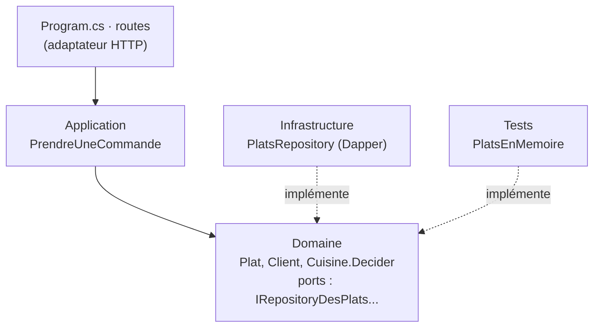

<div class="kicker mb-4">Séance 6 / 6</div>

# C# 101

## L'écosystème & ASP.NET Core

<Zombie kind="hand" pos="bl" :size="6" />
<Zombie kind="zombie" pos="br" :size="6" />

<!--
Dernière séance. On expose le food truck en API HTTP, sur la base PostgreSQL de la séance 4, et on fait le tour des packages qu'on croise en entreprise.
Fil rouge : le Winchester, le food truck pour zombies de la séance 5, stocké dans PostgreSQL.
Rappel logistique : Docker doit tourner sur les postes (Testcontainers).
-->

---

# Au menu

| Temps | Phase |
|---|---|
| 0:00 | C# en entreprise, combien ? |
| 0:10 | ASP.NET Core vu par un dev Spring Boot |
| 0:22 | Architecture hexagonale et repositories |
| 0:30 | L'écosystème NuGet, et une démo |
| 0:40 | Koans en binôme |
| 1:20 | Conclusions et rétro de la formation |

<Zombie kind="brain" pos="br" :size="5" />

---
layout: center
---

# C# en entreprise, combien ?

<div class="text-center text-xl mt-4">

**3 minutes, en binôme** : estimez, puis on compare

</div>

<div class="grid grid-cols-2 gap-4 mt-6 text-center">
  <div class="pill text-base">Quelle part des développeurs pros utilise C# ?</div>
  <div class="pill text-base">Quelle part des projets .NET sont des applications web ?</div>
  <div class="pill text-base">Combien de projets tournent encore sur le vieux .NET Framework ?</div>
  <div class="pill text-base">Rider ou Visual Studio : qui gagne ?</div>
</div>

<Zombie kind="eye" pos="br" :size="4" />

<!--
Connexion (10 min). On affiche les questions, chaque binôme note ses estimations, puis on révèle la slide suivante.
Les écarts sont souvent parlants : beaucoup de Javaistes sous-estiment C#, et sous-estiment le poids du legacy .NET Framework.
-->

---

# Les chiffres

<div class="grid grid-cols-3 gap-4 mt-2">
<div v-click class="callout">

**29,9 %** des développeurs professionnels utilisent C#

<span class="muted small">Stack Overflow Survey 2025</span>

</div>
<div v-click class="callout">

**21,3 %** des pros utilisent ASP.NET Core

<span class="muted small">Stack Overflow Survey 2025</span>

</div>
<div v-click class="callout">

C# élu **langage de l'année 2025**, 5ᵉ du classement

<span class="muted small">TIOBE, janvier 2026</span>

</div>
<div v-click class="callout">

**68 %** développent du web, 50 % des services backend

<span class="muted small">JetBrains, State of .NET 2025</span>

</div>
<div v-click class="callout">

**35 %** utilisent encore .NET Framework : le legacy est bien là

<span class="muted small">JetBrains, State of .NET 2025</span>

</div>
<div v-click class="callout">

Visual Studio **45 %**, Rider **44 %**, VS Code 9 %

<span class="muted small">JetBrains, State of .NET 2025</span>

</div>
</div>

<div v-click class="mt-6 small muted">

TIOBE mesure la popularité dans les moteurs de recherche, pas l'usage : C# y est passé de 7,39 % (janvier) à 3,79 % (octobre 2026) sans changer de rang. Chiffres relevés en octobre 2026.

</div>

<!--
Sources : survey.stackoverflow.co/2025/technology, tiobe.com/tiobe-index, lp.jetbrains.com/the-state-of-dotnet-2025 (3 800 pros, 34 pays).
29 % des répondants JetBrains travaillent dans une entreprise de plus de 1 000 salariés ; 65 % n'envisagent pas de changer de langage dans l'année.
Les chiffres « Fortune 500 » qui circulent n'ont pas de méthodologie publiée : on ne les montre pas.
-->

---
layout: section
---

<div class="kicker mb-3">Partie 01</div>

# ASP.NET Core

---
layout: two-cols
---

# Un contrôleur d'API

```csharp {all|1|2,11|3-4|6-9|12-14|17-19|all}
[ApiController]
[Route("plats")]
public class PlatsController(IRepositoryDesPlats plats)
    : ControllerBase
{
    [HttpGet]
    public async Task<IReadOnlyList<Plat>> Menu(
        [FromQuery] string? categorie)
        => await plats.MenuAsync(categorie);

    [HttpGet("{id:int}")]
    public async Task<ActionResult<Plat>> Trouver(int id)
        => await plats.TrouverAsync(id) is { } plat
            ? Ok(plat) : NotFound();
}

// Program.cs
builder.Services.AddControllers();
app.MapControllers();
```

::right::

<div class="mt-16 small">

<div v-click="1">

- `[ApiController]` ≈ `@RestController` : un modèle invalide donne un 400 en Problem Details, sans une ligne de code

</div>
<div v-click="2">

- `[Route]`, `[HttpGet("{id:int}")]` ≈ `@RequestMapping`, `@GetMapping`, avec le type contraint dans la route

</div>
<div v-click="3">

- L'injection par le constructeur ; une instance de contrôleur par requête

</div>
<div v-click="4">

- `[FromQuery]`, `[FromRoute]`, `[FromBody]` ≈ `@RequestParam`, `@PathVariable`, `@RequestBody`

</div>
<div v-click="5">

- `ActionResult<T>` ≈ `ResponseEntity<T>` ; `Ok()` et `NotFound()` viennent de `ControllerBase`

</div>
<div v-click="6">

- Les contrôleurs sont découverts par réflexion au démarrage (≈ le scan du classpath)

</div>
</div>

<!--
Le style historique d'ASP.NET (Web API, 2012), toujours très présent dans le code existant en entreprise.
Un dev Spring s'y retrouve tout de suite : des classes, des attributs à la place des annotations.
Les attributs [FromRoute] sont implicites pour les paramètres présents dans la route, [FromBody] pour les types complexes.
-->

---
layout: two-cols
---

# Minimal API

```csharp {all|1-4,11|6-9|all}{at:1}
var builder = WebApplication.CreateBuilder(args);
builder.Services
    .AddScoped<IRepositoryDesPlats, PlatsRepository>();
var app = builder.Build();

app.MapGet("/plats/{id:int}",
    async (int id, IRepositoryDesPlats plats) =>
        await plats.TrouverAsync(id) is { } plat
            ? TypedResults.Ok(plat)
            : TypedResults.NotFound());

app.Run();
```

<div v-click="3" class="callout small mt-3">

Ni classe, ni attribut, ni réflexion. Les paramètres de la lambda viennent de la route, de la query string, du body ou de l'injection.

</div>

::right::

<div class="mt-16 ml-6 small">

<div class="kicker mb-2">Une histoire récente</div>

<v-clicks at="4">

- **.NET 6** · novembre **2021** : naissance des Minimal API, avec les top-level statements et `WebApplication`. Le but : la concision d'Express ou de Flask
- **.NET 7** · 2022 : `TypedResults`, `Results<…>`, les groupes de routes `MapGroup`, les filtres
- **.NET 8** · 2023 : compatibles **Native AOT** ; le template `webapi` passe aux Minimal API par défaut
- **.NET 9** · 2024 : OpenAPI natif (`AddOpenApi`)
- **.NET 10** · 2025 : la validation intégrée

</v-clicks>

<div v-click class="callout mt-4">

Contrôleurs ou Minimal API : même pipeline, même injection, on peut mélanger. Les exercices utilisent les Minimal API.

</div>
</div>

<!--
Kestrel est le serveur HTTP intégré (le Tomcat embarqué de Spring Boot).
Pourquoi les Minimal API : moins de cérémonie, démarrage plus rapide, et pas de réflexion, donc compatibles Native AOT.
dotnet new webapi génère des Minimal API depuis .NET 8 ; --use-controllers pour l'ancien style.
-->

---
layout: two-cols-header
---

# ASP.NET Core MVC et Razor

::left::

<div class="kicker mb-2">Le contrôleur</div>

```csharp
// Controllers/MenuController.cs
public class MenuController(IRepositoryDesPlats plats)
    : Controller
{
    public async Task<IActionResult> Index(string? cat)
    {
        var menu = await plats.MenuAsync(cat);
        return View(menu); // -> Views/Menu/Index.cshtml
    }
}
```

::right::

<div class="kicker mb-2">La vue Razor</div>

```razor
@model IReadOnlyList<Plat>
<h1>Le menu du Winchester</h1>
<ul>
  @foreach (var plat in Model)
  {
    <li>
      @plat.Nom : @plat.PrixEnDents dents
      @if (plat.Stock == 0) { <em>(rupture)</em> }
    </li>
  }
</ul>
<a asp-route-cat="Chou-fleur">Menu vegan</a>
```

::bottom::

<div v-click class="grid grid-cols-3 gap-3 mt-2 small">
<div class="callout">Le HTML est produit côté serveur (≈ Spring MVC + Thymeleaf)</div>
<div class="callout"><code>@</code> bascule en C#, et la vue est compilée</div>
<div class="callout">Cousins : <strong>Razor Pages</strong> et <strong>Blazor</strong></div>
</div>

<!--
On ne pratique pas MVC dans les koans (on fait une API), mais c'est très présent dans le code existant en entreprise.
asp-route-cat est un tag helper : ils génèrent l'URL à partir des routes, comme th:href="@{...}" en Thymeleaf.
Blazor reprend la syntaxe Razor pour écrire des composants interactifs, exécutés sur le serveur ou dans le navigateur (WebAssembly).
-->

---

# Les durées de vie dans le conteneur

| | Pour | Dans le FoodTruck | Requête 1 | Requête 1, encore | Requête 2 |
|---|---|---|---|---|---|
| **Singleton** <span class="muted">≈ singleton</span> | partagé, thread-safe, coûteux à créer | `NpgsqlDataSource` | **A** | **A** | **A** |
| **Scoped** <span class="muted">≈ request</span> | lié à la requête | `IRepositoryDesPlats` | **B** | **B** | **C** |
| **Transient** <span class="muted">≈ prototype</span> | léger et sans état | `PrendreUneCommande` | **D** | **E** | **F** |

```csharp
builder.Services.AddSingleton(NpgsqlDataSource.Create(chaine));            // un pool pour toute l'application
builder.Services.AddScoped<IRepositoryDesPlats, PlatsRepository>();        // un repository par requête
builder.Services.AddTransient<PrendreUneCommande>();                       // un cas d'usage à chaque injection
```

<div v-click class="callout mt-4">

**Le piège** : un singleton qui reçoit un service scoped le garde pour toujours (*captive dependency*). Règle d'or : on ne dépend que de services qui vivent **au moins aussi longtemps** que soi. En Development, ASP.NET Core le vérifie au démarrage.

</div>

<!--
La règle d'or : un service ne dépend que de services qui vivent au moins aussi longtemps que lui.
Le koan Les_durees_de_vie_du_FoodTruck vérifie ces trois durées de vie sur les vrais enregistrements de Program.cs.
Configuration : IOptions<T> ≈ @ConfigurationProperties, aussi dans 01_InjectionDeDependances.
-->

---
layout: two-cols
---

# Un refus devient du HTTP

```csharp
// LE CŒUR : une fonction pure
Decision Decider(Client c, Plat p, int quantite)
    => (c, p) switch
    {
        ({ EstVivant: true }, _)
            => new ClientEncoreVivant(c.Nom),
        ({ Type: "Vegan" }, { Categorie: not "Chou-fleur" })
            => new RegimeNonRespecte(c.Nom, p.Categorie),
        _ when p.Stock < quantite
            => new RuptureDeStock(p.Nom, p.Stock),
        _ => new Acceptee()
    };

// LA COQUILLE : l'endpoint traduit en HTTP
ClientEncoreVivant v => TypedResults.Problem(
    title: "Client encore vivant", statusCode: 422),
```

::right::

<div class="mt-16">

```json
HTTP/1.1 422 Unprocessable Entity
Content-Type: application/problem+json

{
  "title": "Client encore vivant",
  "status": 422,
  "detail": "Shaun respire encore."
}
```

<v-clicks>

- *Problem Details* : le format standard des erreurs HTTP (RFC 9457), intégré à ASP.NET Core
- *Functional core, imperative shell* : la règle se teste sans base ni serveur

</v-clicks>

</div>

---
layout: two-cols-header
---

# Tester l'API

::left::

<Lang name="java" />

```java
@SpringBootTest
@AutoConfigureMockMvc
class CommandesTest {
    @Autowired MockMvc mvc;

    @Test
    void shaun_est_refuse() throws Exception {
        mvc.perform(post("/commandes").content(json))
           .andExpect(status().is(422));
    }
}
```

::right::

<Lang name="csharp" />

```csharp
class LaPriseDeCommande(BaseDeDonnees db)
    : AvecLApi(db)
{
    [Fact]
    public async Task Shaun_est_refuse()
    {
        var reponse = await Api.PostAsJsonAsync(
            "/commandes", new NouvelleCommande(4, 1, 1));

        Check.That((int)reponse.StatusCode).IsEqualTo(422);
    }
}
```

::bottom::

<div class="callout small mt-2">

`WebApplicationFactory<Program>` démarre l'API en mémoire, avec son vrai routing, sa sérialisation et son injection, branchée sur le PostgreSQL de Testcontainers.

</div>

---
layout: section
---

<div class="kicker mb-3">Partie 02</div>

# Architecture hexagonale et repositories

---
layout: two-cols
---

# Ports et adaptateurs



::right::

<div class="mt-20">

<v-clicks>

- Le **domaine** au centre : le modèle, les règles, et les **ports**, des interfaces écrites dans son langage
- Les **adaptateurs** autour : HTTP d'un côté, PostgreSQL de l'autre
- Les dépendances pointent **vers** le domaine : il ne connaît ni Npgsql, ni ASP.NET Core
- `Program.cs` : la *composition root* (le seul endroit où un port rencontre son adaptateur) et les routes HTTP
- Pour le vérifier en test : NetArchTest ou ArchUnitNET (≈ ArchUnit)

</v-clicks>

</div>

<!--
Alistair Cockburn, 2005. Aussi appelée « ports and adapters » ; Clean Architecture et Onion en sont des variantes.
Dans le FoodTruck, ce sont des dossiers et des namespaces d'un seul projet. En entreprise, on voit souvent un projet .csproj par couche, pour que le compilateur interdise les mauvaises références.
-->

---
layout: two-cols-header
---

# Un port, des adaptateurs

::left::

<Lang name="java" />

```java
// SPRING DATA JPA : on écrit l'interface...
public interface PlatRepository
        extends JpaRepository<Plat, Integer> {
    List<Plat> findByCategorie(String categorie);
}
// ...et Spring en génère l'implémentation
// au démarrage, à partir du nom des méthodes
```

::right::

<Lang name="csharp" />

```csharp {all|1-6|8-10|12-14|all}{at:1}
// LE PORT, dans le domaine
public interface IRepositoryDesPlats
{
    Task<IReadOnlyList<Plat>> MenuAsync(string? cat);
    Task<Plat?> TrouverAsync(int id);
}

// UN ADAPTATEUR, dans l'infrastructure (Dapper)
public sealed class PlatsRepository(NpgsqlDataSource source)
    : IRepositoryDesPlats { ... }

// LE BRANCHEMENT, dans Program.cs
builder.Services
    .AddScoped<IRepositoryDesPlats, PlatsRepository>();
```

::bottom::

<div v-click="4" class="callout small mt-2">

Pas de génération magique : on écrit l'adaptateur. En test, on branche `PlatsEnMemoire` : le cas d'usage se teste en millisecondes, sans Docker.

</div>

---
layout: two-cols
---

# Entity Framework Core

```csharp
// le DbContext ≈ l'EntityManager de JPA
public class FoodTruckContext(
    DbContextOptions<FoodTruckContext> options)
    : DbContext(options)
{
    public DbSet<Plat> Plats => Set<Plat>();
}

// un AUTRE adaptateur pour le même port
public sealed class PlatsEfCore(FoodTruckContext db)
    : IRepositoryDesPlats
{
    public async Task<IReadOnlyList<Plat>>
        MenuAsync(string? c) => await db.Plats
            .Where(p => c == null || p.Categorie == c)
            .OrderBy(p => p.Id)
            .ToListAsync();   // LINQ traduit en SQL

    public Task<Plat?> TrouverAsync(int id)
        => db.Plats.FindAsync(id).AsTask();
}
```

::right::

<div class="mt-20">

<v-clicks>

- L'ORM officiel de .NET (≈ JPA / Hibernate)
- On écrit du **LINQ** : `IQueryable<T>` le traduit en SQL (séance 3)
- `AddDbContext` l'enregistre en **scoped** : un contexte, et son suivi des modifications, par requête
- Migrations : `dotnet ef migrations add` (≈ Flyway, Liquibase)
- **Dapper ou EF Core ?** Le SQL à la main et la performance, ou la productivité. Avec l'hexagone, on change d'adaptateur sans toucher au domaine.

</v-clicks>

</div>

<!--
Pour mapper les colonnes snake_case de PostgreSQL : le package EFCore.NamingConventions (UseSnakeCaseNamingConvention) ou des attributs [Column].
Provider PostgreSQL : Npgsql.EntityFrameworkCore.PostgreSQL, du même projet que le driver Npgsql.
Le piège classique : le N+1 avec le lazy loading, comme en JPA.
-->

---
layout: section
---

<div class="kicker mb-3">Partie 03</div>

# L'écosystème

---

# NuGet, le Maven Central de .NET

| Besoin | .NET | Java |
|---|---|---|
| Documenter l'API | `Microsoft.AspNetCore.OpenApi` (natif) + **Scalar** ou Swagger UI | springdoc-openapi |
| Observabilité | **OpenTelemetry**, `ILogger`, Serilog | OpenTelemetry, Micrometer, SLF4J |
| Données | **Entity Framework Core**, **Dapper**, Npgsql | JPA / Hibernate, JdbcTemplate |
| Résilience | **Polly**, `Microsoft.Extensions.Http.Resilience` | Resilience4j |
| Validation | validation intégrée (.NET 10), FluentValidation | Bean Validation |
| Tests | xUnit, NUnit, NSubstitute ou Moq, **Testcontainers** | JUnit, Mockito, Testcontainers |
| Orchestration locale | **.NET Aspire** | Docker Compose |

<div class="grid grid-cols-2 gap-4 mt-4 small">
<div class="callout">

`dotnet add package Dapper` · `dotnet list package --vulnerable`

</div>
<div class="callout">

**Licences** : FluentAssertions 8, AutoMapper, MediatR et MassTransit sont devenus payants en 2025. On vérifie avant d'adopter.

</div>
</div>

<!--
Swashbuckle (Swagger) a longtemps été dans les templates ; depuis .NET 9, le document OpenAPI est généré par Microsoft.AspNetCore.OpenApi et on choisit son interface (Scalar, Swagger UI, Redoc).
Anecdote : en préparant cette séance, `dotnet build` a signalé une faille connue dans une dépendance transitive (Microsoft.OpenApi 2.0.0) : NuGet audite les dépendances à chaque restore.
La question des licences explique pourquoi la formation utilise NFluent plutôt que FluentAssertions.
-->

---
layout: two-cols
---

# La démo

```bash
# PostgreSQL + le dashboard Aspire
docker compose up -d

# l'API, en Development
dotnet run --project FoodTruck
```

```csharp
builder.Services.AddOpenApi();
app.MapOpenApi();              // /openapi/v1.json
app.MapScalarApiReference();   // /scalar

builder.Services.AddOpenTelemetry()
    .WithTracing(t => t.AddAspNetCoreInstrumentation()
                       .AddNpgsql())
    .UseOtlpExporter();
```

::right::

<div class="mt-20">

<v-clicks>

- **Scalar** (`localhost:5080/scalar`) : explorer et appeler l'API depuis son contrat OpenAPI
- Passer une commande pour Shaun : 422
- **Dashboard Aspire** (`localhost:18888`) : la trace d'un `POST /commandes`, avec chacune de ses requêtes SQL
- OpenTelemetry est un standard : la même télémétrie part vers Jaeger, Grafana, Datadog...

</v-clicks>

</div>

<!--
Démo (8 min) depuis solutions/s6-aspnet.
1. docker compose up -d, puis dotnet run --project FoodTruck : le navigateur s'ouvre sur Scalar.
2. GET /menu, puis POST /commandes avec clientId 4 (Shaun) : 422 en Problem Details. Puis clientId 1 : 201.
3. Dans le dashboard Aspire, onglet Traces : un POST /commandes compte 5 étendues (HTTP + 4 requêtes PostgreSQL).
4. docker compose down.
-->

---

# Les différences qui piquent

| Java | C# | Piège |
|---|---|---|
| annotations + scan du classpath | `Program.cs` | tout est déclaré, rien n'est magique |
| `@Scope("request")` | `AddScoped` | pas de scoped dans un singleton |
| `@RestController` | `app.MapGet(...)` | les paramètres de la lambda viennent de la route, de la query string, du body ou de l'injection |
| `ResponseEntity<T>` | `Results<Ok<T>, NotFound>` | le type de retour documente les réponses possibles |
| `@ControllerAdvice` | `TypedResults.Problem(...)` | les erreurs au format Problem Details |
| Spring Data génère le repository | on écrit l'adaptateur du port | et on le branche dans `Program.cs` |
| Thymeleaf | Razor (`.cshtml`) | `@` bascule en C#, la vue est compilée |
| `@SpringBootTest` + MockMvc | `WebApplicationFactory<Program>` | l'API tourne en mémoire, pour de vrai |
| springdoc-openapi | `AddOpenApi()` + Scalar | le document OpenAPI est natif |

<Zombie kind="eye" pos="br" :size="3.5" />

---
layout: section
---

<div class="kicker mb-3">Partie 04</div>

# À vous de jouer

<Zombie pos="br" :size="8" />

---

# Le Winchester

<div class="grid grid-cols-2 gap-8">
<div>

```sql
plats     (id, nom, categorie, prix_en_dents, stock)
clients   (id, nom, type, est_vivant)
commandes (id, client_id, plat_id, quantite, passee_le)
```

- 5 plats : des cerveaux, du chou-fleur, et un Tartare de neurones en rupture
- 6 clients, dont deux vegans, et Shaun, qui imite très bien les zombies
- 7 commandes, 174 dents de chiffre d'affaires

</div>
<div>

```
FoodTruck/
├── Domaine/          modèle, Cuisine.Decider, ports
├── Application/      PrendreUneCommande
├── Infrastructure/   adaptateurs PostgreSQL
└── Program.cs        branchement + routes
```

<div class="callout mt-4">

**Docker doit tourner.** Le premier `dotnet test` démarre PostgreSQL (quelques secondes).

</div>

</div>
</div>

---

# 40 minutes, en binôme

| Fichier | Thème |
|---|---|
| `01_InjectionDeDependances.cs` | singleton, scoped, transient, `IOptions<T>`, les durées de vie du FoodTruck |
| `02_MinimalApi.cs` | l'API en mémoire, routes, OpenAPI |
| `03_ArchitectureHexagonale.cs` | un adaptateur en mémoire, le cas d'usage testé sans base ni serveur |
| `04_ExposerLeFoodTruck.cs` | `POST /commandes`, Problem Details, cinq zombies pour trois cerveaux |

<div class="callout mt-6">

On change de pilote à chaque fichier · priorité à **03** et **04**

</div>

<Zombie kind="hand" pos="br" :size="4" />

<!--
26 koans.
Pièges habituels : l'ordre des règles dans Decider (Shaun vegan doit être refusé comme vivant), Task.FromResult pour un adaptateur synchrone (03), la Location attendue est /commandes/8 (04).
Le dernier test de 04 envoie 5 commandes simultanées pour 3 Cerveaux flambés : 3 x 201 et 2 x 409, grâce à l'UPDATE ... WHERE stock >= @Quantite.
-->

---

# Conclusions

<v-clicks>

- Correction live de `PrendreUneCommande` : le cas d'usage qui orchestre les ports
- **Retour à la connexion** : quel chiffre vous a le plus surpris ?
- **Rétro de la formation** : ce que vous emportez, ce qui vous manque encore
- **La suite** : les niveaux 5 à 7 du *.NET Maturity Stack*

</v-clicks>

<!--
Rétro rapide : un post-it « je garde », un post-it « il me manque ». Les manques reviennent souvent vers EF Core, le déploiement (conteneurs, Azure) et les performances (Span<T>, BenchmarkDotNet).
-->

---
layout: end
---

<div class="text-8xl mb-4"><game-icons-brain class="inline" /></div>

# Braaains !

<div class="kicker mt-2">Fin de la formation · Merci</div>
